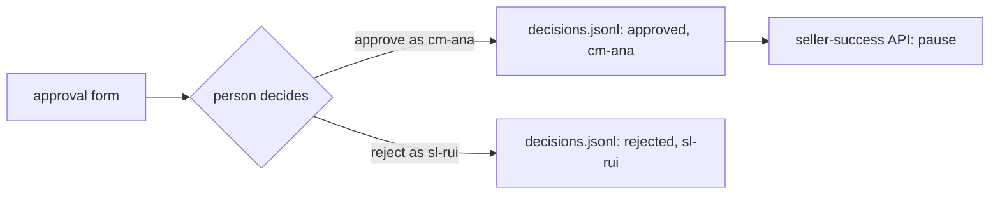

# Log the decision

## The problem

A seller asks: "Who paused my shop, and why?" The desk must answer with a name, a time and the evidence. A pause
with no record is a pause nobody can explain.

The name must come from the session: the person who is signed in. The model also writes names. For example,
the recorded plan says `"approver": "cm-joao"`, but nobody signed in as cm-joao. A log that copies the model's
name records a decision nobody made.



## Your challenge

Open `approve.py` in this folder. It is the solution to ask-before-pausing. In `resume`, write one line to
`kit.decisions_log()` for every decision, approved or rejected. Use `kit.append_line(path, entry)`.

Each line holds:

| Field       | Where it comes from                        | For example                          |
| ----------- | ------------------------------------------ | ------------------------------------ |
| `at`        | the time now, as an ISO time               | `"2026-05-04T10:15:00+00:00"`        |
| `approver`  | `user`: the `--user` of the resume command | `"cm-ana"`                           |
| `decision`  | `"approved"` or `"rejected"`               | `"rejected"`                         |
| `question`  | the run you loaded                         | `"Pause seller ea8482cd, ..."`       |
| `seller_id` | the plan in the run                        | `"ea8482cd71df3c1969d7b9473ff13abc"` |
| `evidence`  | the query ids the form showed              | `["q1", "q2"]`                       |

```bash
uv run python parts/07-approve-the-write/kit.py log-the-decision resume approval-1a2b3c4d5e6f --reject --user sl-rui
```

Expect: `"approved": false`, and one new line in `data/logs/decisions.jsonl` with `"approver": "sl-rui"`. Ask
first, as in ask-before-pausing, and use the id it printed.

## Done when

- Each approval and each rejection writes exactly one line.
- The approver is the signed-in user, never the name the model wrote.
- Each line has the decision, the question, the time and the evidence query ids.
- A run that still waits for a person writes no line.

```bash
bun run verify log-the-decision
```

Expect: `Done. All 4 rules pass.`

## If you get stuck

| What you see                                  | Fix                                                           |
| --------------------------------------------- | ------------------------------------------------------------- |
| `FAIL each approval and each rejection ...`   | Write the line before the `if approved:` test, not inside it. |
| `FAIL the approver is the signed-in user ...` | Use `user`. Never read a name from the plan.                  |
| `FAIL each line has ... the time ...`         | Use `datetime.now(UTC).isoformat()`.                          |

## Words you will use

- **Audit log**: a file that records who did what, and when, so anyone can check it later.
- **Session**: who is signed in right now. The program gets it from `--user`, not from the model.
