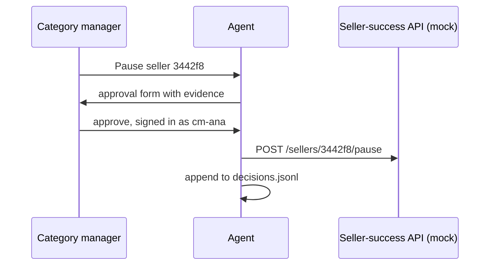

# Approve the write

This part is planned. Its steps are built by a later session; the table below is the contract for that work.

## The problem

Pausing a seller cuts their income. The agent may find the evidence and draft the action, but a named person
decides, and the write never goes through SQL. Grab built its analytics agents to also support fraud
investigation, where every action needs a trail
([Grab Engineering](https://engineering.grab.com/transforming-the-analytics-landscape-with-RAG-powered-LLM)).



## Steps

25 minutes in 2 steps.

| Step                 | Minutes | You produce                                                                           | The check reads                                                                                                      |
| -------------------- | ------- | ------------------------------------------------------------------------------------- | -------------------------------------------------------------------------------------------------------------------- |
| `ask-before-pausing` | 15      | an approval form and an interrupt; the mock API is called only after `approved: true` | without approval the mock API log is empty; after a scripted approval it holds one call; a rejection leaves it empty |
| `log-the-decision`   | 10      | `decisions.jsonl`: approver, time, question, evidence query ids                       | each approval and rejection writes one line whose approver comes from the session, never from the model              |

## Walkthrough

TODO(part session): one command per step, each with its Expect line.

```bash
bun run verify part approve-the-write
```

Expect: `Part approve-the-write is done: 2/2 steps pass.` once the steps exist.
