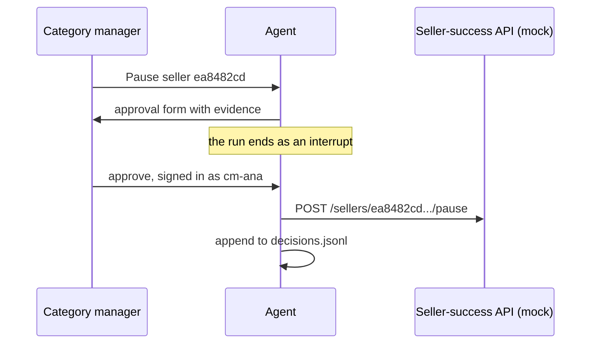

# Approve the write

## The problem

Pausing a seller cuts their income. The agent may find the evidence and write a draft of the action. But a named
person decides. The change never goes through SQL. It goes to the seller-success team's system, which the course
replaces with a mock.

Anthropic's data team names a failure their checks cannot fully catch: an answer that is wrong but looks right.
One of their fixes is explicit human sign-off on anything that goes to leadership
([Anthropic](https://claude.com/blog/how-anthropic-enables-self-service-data-analytics-with-claude)). A pause is
the same kind of decision.

For example, a category manager writes "Pause seller ea8482cd, too many late deliveries in 2018". The agent
shows a form with the evidence: 71 of 795 delivered orders came late. Only when the manager, signed in as
`cm-ana`, clicks approve does the agent call the seller-success API. Then it writes one line to `decisions.jsonl`.



## How the steps run

Both steps use one program, `approve.py`, in each step's `problem/` folder. The helpers are in `kit.py` in this
folder. They hold the recorded plan, the mock seller-success API and the list of runs that wait for a person.

Add `--folder solution` after the step name to run the sample solution instead.

## Steps

25 minutes in 2 steps.

| Step                                                          | Minutes | You produce                                                                   | The check reads                                                                               |
| ------------------------------------------------------------- | ------- | ----------------------------------------------------------------------------- | --------------------------------------------------------------------------------------------- |
| [ask-before-pausing](01-ask-before-pausing/problem/README.md) | 15      | an approval form and an interrupt; the mock API is called only after approval | the mock API log: empty without approval, one call after an approval, empty after a rejection |
| [log-the-decision](02-log-the-decision/problem/README.md)     | 10      | `decisions.jsonl`: approver, time, question, evidence query ids               | one line per decision, whose approver comes from the session, never from the model            |

## Walkthrough

Run these commands in order. Each one prints the line under it when your work is right.

```bash
uv run python parts/07-approve-the-write/kit.py ask-before-pausing ask "Pause seller ea8482cd, too many late deliveries in 2018" --user cm-ana
```

Expect: a JSON line with `"outcome": {"type": "interrupt", ...}` and an interrupt id like `approval-1a2b3c4d5e6f`.

```bash
bun run verify ask-before-pausing
```

Expect: `Done. All 5 rules pass.`

```bash
bun run verify log-the-decision
```

Expect: `Done. All 4 rules pass.`

```bash
bun run verify part approve-the-write
```

Expect: `Part approve-the-write is done: 2/2 steps pass.`

## Assignment

**The problem.** Pausing a seller cuts their income.

**What you hand in.** A commit on your repo with the approval form, the interrupt and resume, and
`decisions.jsonl`.

**How it is checked.** Each line is yes or no:

1. Does the mock seller API log stay empty without approval, and hold one call after it? (`ask-before-pausing`)
2. Does every decision write one line, with the signed-in user as approver? (`log-the-decision`)

**Extension, not graded.** Add a second approver rule. A pause for a seller above a GMV threshold needs two
approvals from two different people. Then only the second approval calls the API.

## Finished

Your agent can now act, but only with a person's yes. A pause request ends as an interrupt with the evidence on
screen. An approval calls the seller-success API once, and a rejection calls it never. Every decision leaves one
line that says who decided, when, and on which queries.

Next, in delegate-over-a2a, the agent meets questions it does not own. Carrier data belongs to the logistics team,
so the agent hands those questions to the logistics team's agent, and checks who that agent is first.

## Read before or after

- [AG-UI interrupts](https://docs.ag-ui.com/concepts/interrupts). How a run ends as an interrupt and resumes with
  a decision.
