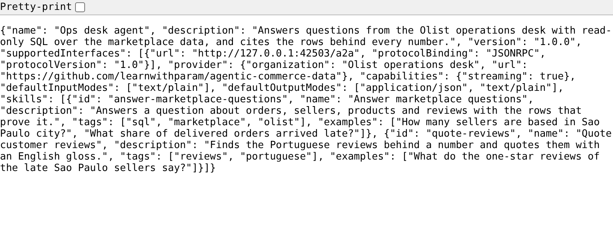

# Publish the card

## The problem

Other teams want to send work to your ops desk agent. First they need to know what it is and how to reach it.
In A2A, an agent says this in an Agent Card. An Agent Card is a small JSON file at a fixed address:
`/.well-known/agent-card.json`.

Your card today is not ready. It lists no skills, and it does not say which version of A2A it speaks. Another
agent that reads it learns nothing useful.



## Your challenge

Fill in `agent-card.json` in this folder so it is a valid A2A 1.0 card. The server in `ops_agent.py` already
serves the file. You only edit the JSON.

A2A 1.0 changed the card. In version 0.3, `url` and `protocolVersion` sat at the top of the card. In 1.0 they
live in a list called `supportedInterfaces`. Each entry says where the agent listens and how.

For example, this is one entry:

```json
{ "url": "http://127.0.0.1:8810/a2a", "protocolBinding": "JSONRPC", "protocolVersion": "1.0" }
```

Then add at least one skill. A skill needs an `id`, a `name`, a `description`, a list of `tags` and a list of
`examples`. An example is a real question someone may send, such as
`How many sellers are based in Sao Paulo city?`.

Start the server and look at your card:

```bash
uv run parts/08-delegate-over-a2a/01-publish-the-card/problem/ops_agent.py serve --port 8810
```

Expect: `The ops desk agent is serving on http://127.0.0.1:8810`. Open that address with
`/.well-known/agent-card.json` at the end. Press Ctrl+C to stop the server.

## Done when

- The server answers `GET /.well-known/agent-card.json` with your card.
- The card validates against the A2A 1.0 schema in `parts/08-delegate-over-a2a/agent-card.schema.json`.
- One entry in `supportedInterfaces` uses `JSONRPC` and protocol version `1.0`.
- Every skill has an id, a description and at least one example.

```bash
bun run verify publish-the-card
```

Expect: `Done. All 5 rules pass.`

## If you get stuck

| What you see                        | Fix                                                                                   |
| ----------------------------------- | ------------------------------------------------------------------------------------- |
| `FAIL agent-card.json is valid ...` | A comma is missing or extra. Paste the file into any JSON checker.                    |
| `FAIL the served card validates`    | Run the validator below. It prints the path of each problem.                          |
| `additionalProperties ... 'url'`    | That is the old 0.3 shape. Move `url` into `supportedInterfaces` and delete the rest. |
| `FAIL ... examples`                 | Add `"examples": ["..."]` to every skill, with one real question.                     |

This command checks any card. Here it checks the card in this folder:

```bash
uv run parts/08-delegate-over-a2a/validate_card.py < parts/08-delegate-over-a2a/01-publish-the-card/problem/agent-card.json
```

Expect: `valid`, or one line per problem with its JSON path.

## Words you will use

- **A2A**: Agent2Agent, an open standard for one agent to send a task to another agent.
- **Agent Card**: the JSON file that says who an agent is, what it can do and where to reach it.
- **Skill**: one job the agent offers, with examples of requests it handles.
- **Well-known address**: a fixed path, here `/.well-known/agent-card.json`, so anyone can find the card.
