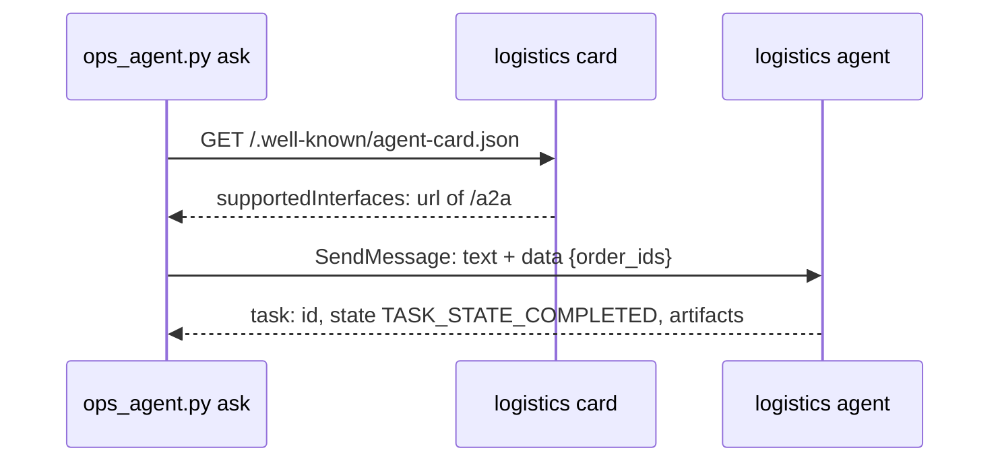

# Delegate to logistics

## The problem

A category manager asks: "Why was order `9b189f6cf2ef734a7dd0419ed3c64d99` delivered late?" Your database
knows the order was 12 days late. It does not know why. The carrier data belongs to the logistics team, and
they run their own agent.

Today your agent gives up on this question. You make it hand the question to the logistics agent as an A2A task,
and bring back the answer.



## Your challenge

Write `send_task` in `a2a_client.py`. The rest of the agent is ready: it finds the order ids in the question,
reads the remote card and calls `send_task`.

A message carries parts. Send two parts: the question as text, and the order ids as data. The logistics agent
reads the ids from the data part. `request_for` already builds this request for you.

For example, the request looks like this:

```json
{
  "jsonrpc": "2.0",
  "id": 1,
  "method": "SendMessage",
  "params": {
    "message": {
      "messageId": "...",
      "role": "ROLE_USER",
      "parts": [{ "text": "Why was order 9b18... late?" }, { "data": { "order_ids": ["9b18..."] } }]
    }
  }
}
```

The reply holds the finished task in `result.task`. Return its `id`, its `status.state`, and the text parts of
its artifacts.

Start the logistics agent in one terminal:

```bash
uv run parts/08-delegate-over-a2a/logistics_agent.py
```

Expect: `The logistics agent is serving on http://127.0.0.1:8811`.

Then ask in a second terminal:

```bash
uv run parts/08-delegate-over-a2a/02-delegate-to-logistics/problem/ops_agent.py ask "Why was order 9b189f6cf2ef734a7dd0419ed3c64d99 late?"
```

Expect: `9b189f6c: Carrier Coast, sent back to the depot after a failed delivery attempt.`

## Done when

- Each of 3 hand-off answers has route `handoff` and a task id.
- Every task id is in the logistics agent's own task log.
- The logistics agent got the order ids of each question.
- Every task ends `TASK_STATE_COMPLETED`, and the answer carries the result for every order.

```bash
bun run verify delegate-to-logistics
```

Expect: `Done. All 5 rules pass.`

## If you get stuck

| What you see                           | Fix                                                               |
| -------------------------------------- | ----------------------------------------------------------------- |
| `send_task is not written yet`         | Open `a2a_client.py` and follow the TODO.                         |
| `could not read the Agent Card`        | Start the logistics agent first, in its own terminal.             |
| `task ended TASK_STATE_REJECTED`       | The ids were not in a data part. Use `request_for`; it adds them. |
| `FAIL every task id is in the ... log` | The id must come from the reply. Never make one up.               |

## Words you will use

- **Task**: one piece of work on the other agent, with an id and a state.
- **Task state**: where the task is, such as `TASK_STATE_WORKING` or `TASK_STATE_COMPLETED`.
- **Part**: one piece of a message: text, data or a file.
- **Artifact**: what the task produced, such as the carrier report.
- **JSON-RPC**: a way to call a method on a server by sending JSON with a method name and its inputs.
