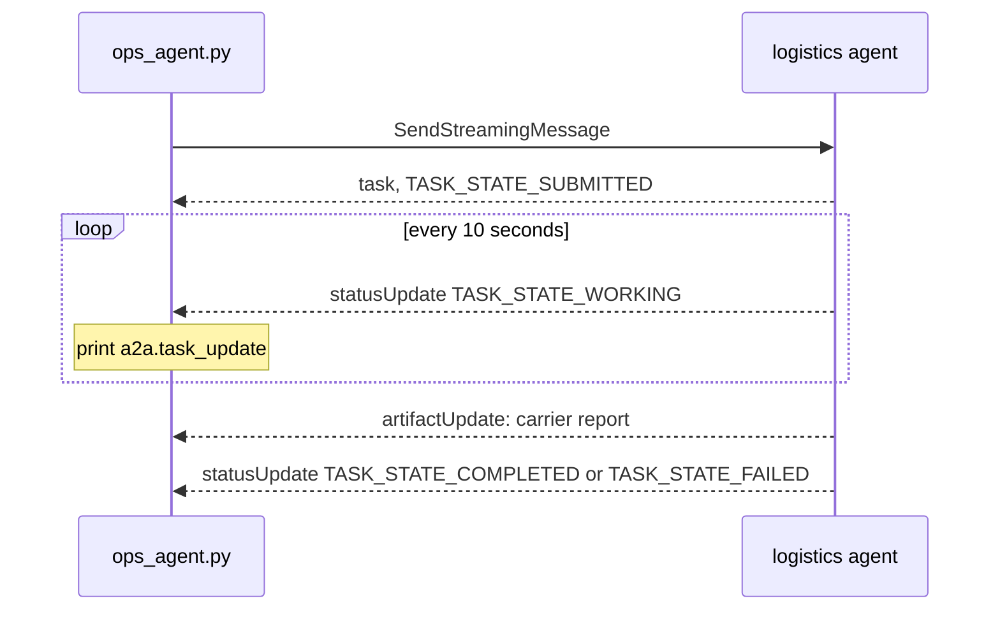

# Stream the task

## The problem

Eon runs about 20 agents, and 3 of them talk over A2A. It wrote down two problems
([AAIF blog](https://aaif.io/blog/what-we-learned-putting-a2a-into-production)). A send that waited for the whole
answer failed at its gateway's 60-second limit. And error events got lost, so a failed task looked like silence.

Your agent has both problems. `send_task` waits for the whole task. When the carriers are slow, the logistics
team's gateway closes the request after 60 seconds, and your agent gets `HTTP Error 504`.



## Your challenge

Switch to `SendStreamingMessage`. The reply is a stream of server-sent events. A server-sent event is one line
that starts with `data:`, sent as soon as something happens. Each one holds a `task`, a `statusUpdate` or an
`artifactUpdate`. The updates keep the line busy, so the gateway never closes it.

1. In `a2a_client.py`, write `stream_task(card, question, order_ids, on_update)`. Read each `data:` line, keep
   the task id and the last state, call `on_update` on each status update, and keep the artifact's text.
2. In `ops_agent.py`, call `stream_task` with `events.task_update`. That prints each update as an event.
3. When the last state is not `TASK_STATE_COMPLETED`, set the answer's `error`.

For example, a slow task prints lines like these before the answer:

```json
{
  "type": "CUSTOM",
  "name": "a2a.task_update",
  "value": { "state": "TASK_STATE_WORKING", "text": "Still asking." }
}
```

Try it with a slow logistics agent. `A2A_CLOCK_SPEED=20` runs its clock 20 times faster, so 70 seconds take 3.5:

```bash
A2A_CLOCK_SPEED=20 uv run parts/08-delegate-over-a2a/logistics_agent.py --slow 70
```

Expect: `The logistics agent is serving on http://127.0.0.1:8811`. Ask the same question as before.

## Done when

- With the logistics agent slowed to 70 seconds, the answer still completes.
- The logistics agent's log shows `SendStreamingMessage`.
- At least two `TASK_STATE_WORKING` updates reach the user.
- When the carrier system fails, the answer has an error and a `RUN_ERROR` event.

```bash
bun run verify stream-the-task
```

Expect: `Done. All 4 rules pass.`

## If you get stuck

| What you see                                | Fix                                                                      |
| ------------------------------------------- | ------------------------------------------------------------------------ |
| `HTTP Error 504: Gateway Timeout`           | You still call `send_task`. Call `stream_task` instead.                  |
| `the stream ended before the task finished` | Keep reading until a final state: completed, failed, canceled, rejected. |
| `FAIL when the carrier system fails ...`    | A `TASK_STATE_FAILED` task must set `error`. Never report it as done.    |

## Words you will use

- **Streaming**: the server sends each update as it happens, instead of one answer at the end.
- **Server-sent events**: a stream of `data:` lines over one HTTP response.
- **Gateway**: the server in front of an agent. It closes a request that waits too long.
- **AG-UI event**: an event your user's screen reads, such as `RUN_STARTED` or `RUN_ERROR`.
