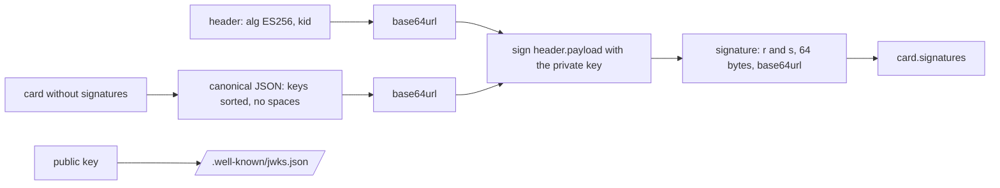

# Sign the card

## The problem

Anyone can serve a JSON file that says "Ops desk agent". A card alone does not prove who wrote it. A2A 1.0 lets
an agent sign its card. The signature is made with a private key. Anyone can check it with the public key, and
one changed byte breaks it.



## Your challenge

Write two functions in `card_signing.py`. The server already calls them.

1. `canonical_json(value)`: the same bytes for the same card, on every computer. Sort the keys and drop every
   space: `json.dumps(value, sort_keys=True, separators=(",", ":"), ensure_ascii=False)`.
2. `signed_card(card, private_key, key_id)`: follow the TODO in the file. The signing input is the base64url
   header, a dot, and the base64url canonical card.

One trap: the `cryptography` package returns a DER signature. JWS wants the two numbers `r` and `s` side by
side, 32 bytes each. `decode_dss_signature` gives you `r` and `s`.

For example, the protected header of your card decodes to:

```json
{ "alg": "ES256", "kid": "ops-desk-key-1", "typ": "JOSE" }
```

Run the server and read both addresses:

```bash
uv run parts/08-delegate-over-a2a/04-sign-the-card/problem/ops_agent.py serve --port 8810
```

Expect: `The ops desk agent is serving on http://127.0.0.1:8810`. The first run creates a key in
`data/keys/`, which git ignores.

## Done when

- The card has a signature whose header says `ES256` and names a `kid`.
- `/.well-known/jwks.json` serves a public key with that `kid`.
- The signature verifies over the card's canonical JSON, and fails when one byte changes.
- The signed card still validates against the A2A 1.0 schema.

```bash
bun run verify sign-the-card
```

Expect: `Done. All 5 rules pass.`

## If you get stuck

| What you see                                    | Fix                                                                  |
| ----------------------------------------------- | -------------------------------------------------------------------- |
| `FAIL the served card has a signature ...`      | `signed_card` still returns the card unchanged. Follow its TODO.     |
| `FAIL the signature verifies ...`               | Sign the canonical JSON, not `indent=2`. Send 64 raw bytes, not DER. |
| `FAIL ... validates against the A2A 1.0 schema` | A signature holds only `protected` and `signature`.                  |

## Words you will use

- **JWS**: JSON Web Signature, a standard way to sign JSON.
- **ES256**: a signature made with a P-256 elliptic curve key and SHA-256.
- **Canonical JSON**: one fixed way to write a JSON value, so signer and checker hash the same bytes.
- **JWKS**: JSON Web Key Set, a list of public keys at `/.well-known/jwks.json`.
- **kid**: key id, the name that says which key made a signature.
