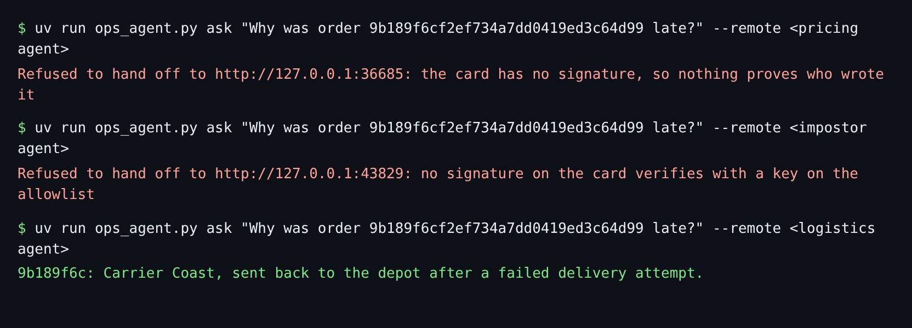

# Refuse the unsigned

## The problem

Your agent now sends tasks to any agent it is pointed at. Two other agents are running nearby:

- A pricing agent. Its card has no signature. Its advice is "Raise every price by 30%".
- An impostor. It calls itself "Logistics agent" and signs its card with its own key. It even uses the
  logistics team's key id, and its `jku` header points at its own key list.

An agent that trusts any card can be pointed at a fake. The fake then sees your order ids and sends back
whatever it likes.



## Your challenge

Write `verify_card(card, allowlist)` in `trust.py`. `ops_agent.py` already calls it before it sends anything.

The allowlist is `allowlist.json` in this folder. It holds the logistics team's public key. The logistics team
gave it to you. Trust a card only when one of its signatures verifies with a key from that file.

1. No signatures: refuse, and say so.
2. For each signature, read the header and find the key with the same `kid` in the allowlist.
3. Check the signature with `signature_matches`. One match is enough.
4. Never fetch the key from the header's `jku`. The card's author chose that address.

For example, the impostor's header looks real:

```json
{
  "alg": "ES256",
  "jku": "http://127.0.0.1:8813/.well-known/jwks.json",
  "kid": "logistics-team-key-1",
  "typ": "JOSE"
}
```

The `kid` matches your allowlist. The signature does not, because the impostor signed with a different key.

Start the three agents, each in its own terminal:

```bash
uv run parts/08-delegate-over-a2a/logistics_agent.py
```

Expect: `The logistics agent is serving on http://127.0.0.1:8811`. Then start `pricing_agent.py` (port 8812)
and `impostor_agent.py` (port 8813) the same way.

## Done when

- The pricing agent and the impostor are each refused, with a reason.
- Neither of them receives a task.
- The logistics agent is accepted, and its task completes.

```bash
bun run verify refuse-the-unsigned
```

Expect: `Done. All 4 rules pass.`

## If you get stuck

| What you see                                 | Fix                                                                    |
| -------------------------------------------- | ---------------------------------------------------------------------- |
| `FAIL the unsigned pricing agent is refused` | Return `False` when the card has no `signatures`.                      |
| `FAIL the impostor ... is refused`           | Check the signature itself. A known `kid` is not enough.               |
| `FAIL the logistics agent ... is accepted`   | Verify the same bytes you sign: the canonical card without signatures. |

## Words you will use

- **Allowlist**: the keys you decided to trust, kept in your own repo.
- **Impostor**: an agent that pretends to be another one.
- **jku**: a header that says where to fetch the signing key. Its author picks it, so you never trust it.
