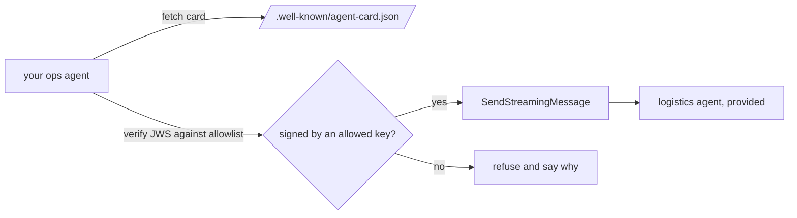

# Delegate over A2A

This part is planned. Its steps are built by a later session; the table below is the contract for that work.

## The problem

Carrier data belongs to the logistics team, which runs its own agent. Eon, which moved 3 of about 20 agents out of
process over A2A, found that a blocking send failed at its gateway's 60-second limit and that error events were
dropped silently ([AAIF blog](https://aaif.io/blog/what-we-learned-putting-a2a-into-production)). An agent that
accepts any card from any host can be pointed at an impostor.



## Steps

35 minutes in 5 steps.

| Step                    | Minutes | You produce                                                 | The check reads                                                                                        |
| ----------------------- | ------- | ----------------------------------------------------------- | ------------------------------------------------------------------------------------------------------ |
| `publish-the-card`      | 7       | an Agent Card at `/.well-known/agent-card.json`             | the card validates against the pinned A2A 1.0 schema; every skill has an id, description and examples  |
| `delegate-to-logistics` | 10      | hand-off questions go to the logistics agent as an A2A task | 3 hand-off answers carry the logistics task id; each task ends `TASK_STATE_COMPLETED`                  |
| `stream-the-task`       | 6       | the call streams and passes task updates on                 | with the logistics agent slowed to 70 seconds the answer completes; an injected error reaches the user |
| `sign-the-card`         | 6       | a signed card (JWS, ES256) and `/.well-known/jwks.json`     | the signature verifies; changing one byte of the card fails verification                               |
| `refuse-the-unsigned`   | 6       | every remote card is verified against your own allowlist    | the unsigned pricing agent and a card signed by an unknown key are refused; logistics is accepted      |

## Walkthrough

TODO(part session): one command per step, each with its Expect line.

```bash
bun run verify part delegate-over-a2a
```

Expect: `Part delegate-over-a2a is done: 5/5 steps pass.` once the steps exist.
