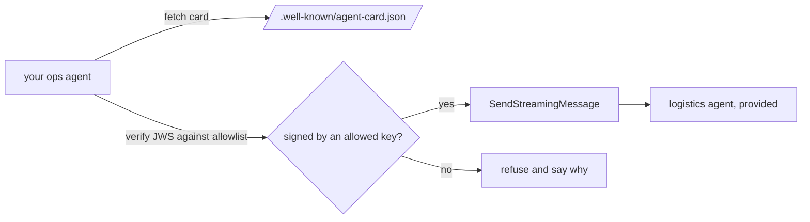

# Delegate over A2A

This part is planned. Its steps do not exist yet. The table below says what each step will ask you to build, and
what its check will read.

## The problem

The carrier data belongs to the logistics team. That team runs its own agent. Your agent must pass carrier
questions to it. A2A is a standard way for one agent to send a task to another agent.

Eon moved 3 of its about 20 agents to separate services that talk over A2A. It learned two things
([AAIF blog](https://aaif.io/blog/what-we-learned-putting-a2a-into-production)):

- A send that waited for the full answer failed at its gateway's 60-second limit.
- Error events were lost, and nobody saw a message.

Trust is a problem too. Each agent publishes an Agent Card, a small file that says who it is and what it can do.
An agent that accepts any card from any server can be tricked into talking to a fake.

For example, this part will give you a pricing agent with no signature on its card. Your agent must refuse it. The
logistics agent signs its card with a key on your list, so your agent accepts it.



## Steps

35 minutes in 5 steps.

| Step                    | Minutes | You produce                                                 | The check reads                                                                                        |
| ----------------------- | ------- | ----------------------------------------------------------- | ------------------------------------------------------------------------------------------------------ |
| `publish-the-card`      | 7       | an Agent Card at `/.well-known/agent-card.json`             | the card validates against the pinned A2A 1.0 schema; every skill has an id, description and examples  |
| `delegate-to-logistics` | 10      | hand-off questions go to the logistics agent as an A2A task | 3 hand-off answers carry the logistics task id; each task ends `TASK_STATE_COMPLETED`                  |
| `stream-the-task`       | 6       | the call streams and passes task updates on                 | with the logistics agent slowed to 70 seconds the answer completes; an injected error reaches the user |
| `sign-the-card`         | 6       | a signed card (JWS, ES256) and `/.well-known/jwks.json`     | the signature verifies; changing one byte of the card fails verification                               |
| `refuse-the-unsigned`   | 6       | every remote card is verified against your own allowlist    | the unsigned pricing agent and a card signed by an unknown key are refused; logistics is accepted      |

## Walkthrough

TODO(part session): one command per step, each with its Expect line.

```bash
bun run verify part delegate-over-a2a
```

Expect: `Part delegate-over-a2a is done: 5/5 steps pass.` once the steps exist.
