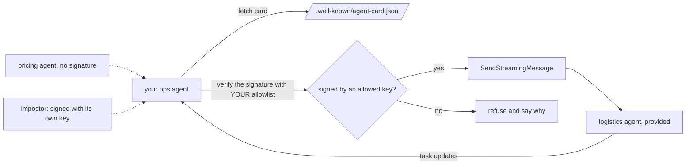

# Delegate over A2A

## The problem

Some questions need data your desk does not own. For example, a category manager asks: "Why was order
`9b189f6cf2ef734a7dd0419ed3c64d99` delivered late?" Your database says it came 12 days after the estimate.
Only the logistics team knows why. Their carrier data lives in their own system, behind their own agent.

A2A (Agent2Agent) is an open standard for this. One agent sends a task to another agent and gets the result back.
It is a Linux Foundation project. Its partner page lists 180 organisations
([A2A partners](https://github.com/a2aproject/A2A/blob/main/docs/partners.md), read from commit `d18aa92`).

Two things go wrong when teams start with A2A:

- **A slow task.** A request that waits for the whole answer can hit a gateway time limit. A gateway is the server
  in front of an agent. Here it closes any request that waits more than 60 seconds.
- **A fake agent.** Each agent publishes an Agent Card, a small file that says who it is. An agent that believes
  any card can be pointed at an impostor. A2A 1.0 lets an agent sign its card, so you can check who wrote it.

In this part your ops agent does five things. It publishes its own card. It hands carrier questions to the
logistics agent. It streams the task, so slow work and errors reach the user. It signs its card. And it refuses
agents it cannot verify.



The other teams' agents come with this part. You do not change them:

| File                     | What it is                                                                                                 |
| ------------------------ | ---------------------------------------------------------------------------------------------------------- |
| `logistics_agent.py`     | The logistics agent. It signs its card with the key in your allowlist.                                     |
| `pricing_agent.py`       | A pricing agent with no signature on its card.                                                             |
| `impostor_agent.py`      | An impostor. It signs its card with its own key and calls itself the logistics agent.                      |
| `team_server.py`         | The small A2A server the three share, in plain Python you can read.                                        |
| `logistics-key.pem`      | The logistics agent's private key. It is a course test key, public on purpose. Never use it anywhere else. |
| `agent-card.schema.json` | The A2A 1.0 Agent Card schema, written from the spec's `a2a.proto` at v1.0.1.                              |

## Steps

35 minutes in 5 steps.

| Step                                                                | Minutes | You produce                                               | The check reads                                                              |
| ------------------------------------------------------------------- | ------- | --------------------------------------------------------- | ---------------------------------------------------------------------------- |
| [publish-the-card](01-publish-the-card/problem/README.md)           | 7       | an Agent Card at `/.well-known/agent-card.json`           | the card your server serves, against the pinned A2A 1.0 schema               |
| [delegate-to-logistics](02-delegate-to-logistics/problem/README.md) | 10      | hand-off questions go to the logistics agent as A2A tasks | the logistics agent's own task log: task ids, order ids, final states        |
| [stream-the-task](03-stream-the-task/problem/README.md)             | 6       | the hand-off streams and passes task updates on           | a 70-second task behind a 60-second gateway, and a task that fails           |
| [sign-the-card](04-sign-the-card/problem/README.md)                 | 6       | a signed card (JWS, ES256) and `/.well-known/jwks.json`   | the signature, verified with your public key; one changed byte must break it |
| [refuse-the-unsigned](05-refuse-the-unsigned/problem/README.md)     | 6       | every remote card is checked against your own allowlist   | which of the logistics, pricing and impostor agents got a task               |

## Walkthrough

Each step folder holds your starting files in `problem/`. You edit them there. Run every command from the repo
root. Commands that start a server keep running, so give each server its own terminal and stop it with Ctrl+C.

**publish-the-card.** Fill in `agent-card.json`, then start your server:

```bash
uv run parts/08-delegate-over-a2a/01-publish-the-card/problem/ops_agent.py serve --port 8810
```

Expect: `The ops desk agent is serving on http://127.0.0.1:8810`.

```bash
bun run verify publish-the-card
```

Expect: `Done. All 5 rules pass.`

**delegate-to-logistics.** Start the logistics agent in its own terminal:

```bash
uv run parts/08-delegate-over-a2a/logistics_agent.py
```

Expect: `The logistics agent is serving on http://127.0.0.1:8811`.

Write `send_task` in `a2a_client.py`, then ask a carrier question:

```bash
uv run parts/08-delegate-over-a2a/02-delegate-to-logistics/problem/ops_agent.py ask "Why was order 9b189f6cf2ef734a7dd0419ed3c64d99 late?"
```

Expect: `9b189f6c: Carrier Coast, sent back to the depot after a failed delivery attempt.`

```bash
bun run verify delegate-to-logistics
```

Expect: `Done. All 5 rules pass.`

**stream-the-task.** Stop the logistics agent and start it again, slow, with a fast clock:

```bash
A2A_CLOCK_SPEED=20 uv run parts/08-delegate-over-a2a/logistics_agent.py --slow 70
```

Expect: `The logistics agent is serving on http://127.0.0.1:8811`.

```bash
uv run parts/08-delegate-over-a2a/03-stream-the-task/problem/ops_agent.py ask "Why was order 9b189f6cf2ef734a7dd0419ed3c64d99 late?" --json --events
```

Expect: before your change, an answer whose `error` says `HTTP Error 504: Gateway Timeout`. After it, several
`a2a.task_update` lines and an answer with `"state": "TASK_STATE_COMPLETED"`.

```bash
bun run verify stream-the-task
```

Expect: `Done. All 4 rules pass.`

**sign-the-card.** Write `canonical_json` and `signed_card`, then check both addresses:

```bash
bun run verify sign-the-card
```

Expect: `Done. All 5 rules pass.`

**refuse-the-unsigned.** Write `verify_card` in `trust.py`. The check starts all three team agents itself:

```bash
bun run verify refuse-the-unsigned
```

Expect: `Done. All 4 rules pass.`

Then check the whole part:

```bash
bun run verify part delegate-over-a2a
```

Expect: `Part delegate-over-a2a is done: 5/5 steps pass.`

```text
Part delegate-over-a2a:
  PASS   publish-the-card  (5/5 rules)
  PASS   delegate-to-logistics  (5/5 rules)
  PASS   stream-the-task  (4/4 rules)
  PASS   sign-the-card  (5/5 rules)
  PASS   refuse-the-unsigned  (4/4 rules)
Part delegate-over-a2a is done: 5/5 steps pass.
```

## Assignment

The problem: carrier data belongs to another team, and your agent must reach it without trusting a stranger.

Hand in a commit on your course repo with your five finished step folders. The grader answers each question with
yes or no:

| #   | Question                                                                                    | How it is checked                      |
| --- | ------------------------------------------------------------------------------------------- | -------------------------------------- |
| 1   | Does your card validate against the A2A 1.0 schema, with an example on every skill?         | `bun run verify publish-the-card`      |
| 2   | Do 3 hand-off questions end as completed tasks in the logistics agent's own log?            | `bun run verify delegate-to-logistics` |
| 3   | Does a 70-second task complete, and does a failed task reach the user as an error?          | `bun run verify stream-the-task`       |
| 4   | Does your card's signature verify with your published key, and break when one byte changes? | `bun run verify sign-the-card`         |
| 5   | Are the pricing agent and the impostor refused, and the logistics agent accepted?           | `bun run verify refuse-the-unsigned`   |

Extension, not graded: rotate your signing key. Put two signatures on the card: one from the old key and one from the new. Then show that a client with
either key in its allowlist accepts the card.

## Finished

You now have an ops agent that other agents can find. It hands work it does not own to the team that owns it.
It keeps the user informed while a slow task runs. And it talks only to agents whose cards it can verify.
For example, it accepts the logistics agent and refuses the impostor, even though both call themselves
"Logistics agent".

The next part, gate-every-change, puts all of this behind a gate. A change to a prompt, a model, a metric or a
card must pass the golden set and the attacks before it can merge.

## Read before or after

- [What's new in A2A v1](https://github.com/a2aproject/A2A/blob/main/docs/whats-new-v1.md): `supportedInterfaces`,
  signed Agent Cards and the well-known card address.
- [A2A specification, section 8.4, Agent Card Signing](https://github.com/a2aproject/A2A/blob/main/docs/specification.md):
  the canonical JSON (RFC 8785) and the JWS format. You build the JWS format in sign-the-card. Your canonical
  JSON is a simpler version of RFC 8785 that is enough for cards.
- [a2a-python `samples/agent_card_signing.py`](https://github.com/a2aproject/a2a-python/blob/main/samples/agent_card_signing.py):
  the same signing and checking, with the official Python SDK.
