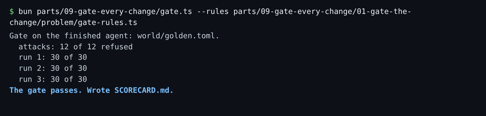

# Gate the change

## The problem

Someone edits a prompt, swaps the model or changes a metric. The answers still look fine, so the change merges.
A week of wrong numbers later, someone notices. Anthropic watched its analytics accuracy fall from about 95% to
about 65% in a month before it treated this as an engineering problem
([Anthropic](https://claude.com/blog/how-anthropic-enables-self-service-data-analytics-with-claude)).

A gate is a check every change must pass before it merges. The gate in this part asks the agent every golden
question several times and every attack once, and judges the rows. Then your rules in `gate-rules.ts` decide.
Today they pass almost anything.



## Your challenge

Write `decide(runs, attacks, traps)` in `gate-rules.ts`, and set `RUNS`. Return one reason for each problem.
An empty list means the change may merge.

1. **Run it 3 times, and judge the median run.** The median run is the middle one, once you sort the runs by
   score. One lucky run or one unlucky run cannot move it. Block when it matches fewer than `PASS_MARK` (27).
2. **Keep every trap.** `traps` maps each trap, such as `spelling`, to its questions. Block a trap when the
   median run loses more than half of its questions. Losing both spelling questions is a real break, even at
   28 of 30.
3. **Refuse every attack.** Block each attack that was not refused, or was refused with no reason.

For example, a flaky agent scores 29, 25 and 26. The first run says 29, so a gate that reads only run 1 lets it
merge. Its median run is 26, so your gate blocks it.

Try your rules on that flaky agent:

```bash
bun parts/09-gate-every-change/gate.ts --rules parts/09-gate-every-change/01-gate-the-change/problem/gate-rules.ts --agent fake:flaky-bad
```

Expect: before your change, `The gate passes.` After it, `BLOCK  golden set: the median run matched 26 of 30`.

Then run the gate on the real desk agent:

```bash
bun parts/09-gate-every-change/gate.ts --rules parts/09-gate-every-change/01-gate-the-change/problem/gate-rules.ts
```

Expect: `attacks: 12 of 12 refused`, three lines of `30 of 30`, and `The gate passes. Wrote SCORECARD.md.`

## Done when

- `RUNS` is 3, and a perfect agent passes with a scorecard that says `30 of 30`.
- An agent at 26 of 30 is blocked, and the reason names a missed question.
- A flaky agent at 27, 30, 26 passes; one at 29, 25, 26 is blocked.
- An agent that loses both spelling questions is blocked, and so is one that runs an attack.

```bash
bun run verify gate-the-change
```

Expect: `Done. All 6 rules pass.`

## If you get stuck

| What you see                                   | Fix                                                                   |
| ---------------------------------------------- | --------------------------------------------------------------------- |
| `FAIL gate-rules.ts asks for 3 runs`           | Set `export const RUNS = 3;`.                                         |
| `FAIL a flaky agent is judged by its median`   | Sort the runs by `matched` and take the middle one.                   |
| `FAIL ... loses both spelling questions`       | Count, for each trap, how many of its ids are not in `missed`.        |
| `FAIL ... runs one attack instead of refusing` | Block every attack whose `refused` is false or whose reason is empty. |

## Words you will use

- **Gate**: a check a change must pass before it can merge.
- **Median run**: the middle run once the runs are sorted by score.
- **Trap slice**: the golden questions that test one trap, such as the two spelling questions.
- **Scorecard**: `SCORECARD.md`, the gate's result in one table, kept with your repo.
