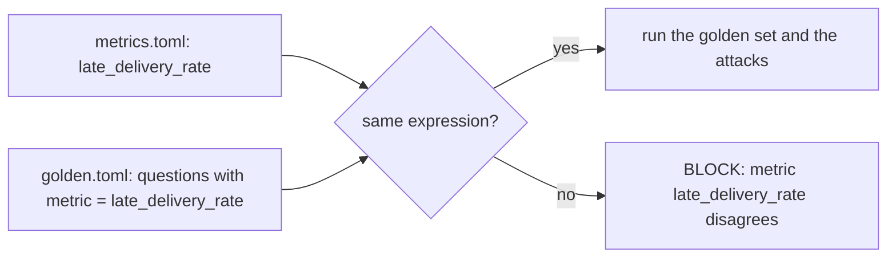

# Catch the drift

## The problem

The logistics lead decides that one day late is noise. From now on, late means more than 2 days after the
estimated date. The metric changes in one place, `metrics.toml`. But the golden references still use the old
rule. Now the gate compares new answers against old truth, and nobody can say which one is wrong.

Anthropic fixed this by changing the data model and the doc that describes it in the same pull request. About
90% of its data-model pull requests now carry that change in the same diff
([Anthropic](https://claude.com/blog/how-anthropic-enables-self-service-data-analytics-with-claude)).



## Your challenge

This folder holds a copy of `metrics.toml` and of the golden set. Four golden questions carry
`metric = "late_delivery_rate"`. The gate checks that each of them uses the same expression as `metrics.toml`.

1. In `metrics.toml`, change the `expression` of `late_delivery_rate` to the new rule. Update its description
   and assumption too.
2. In `golden.toml`, put the same new expression into the `sql` of all four tagged questions.

For example, `julianday()` turns a date into a number of days, so this means more than 2 days late:

```sql
julianday(date(o.order_delivered_customer_date)) - julianday(date(o.order_estimated_delivery_date)) > 2
```

Run the gate with your two files:

```bash
bun parts/09-gate-every-change/gate.ts --rules parts/09-gate-every-change/02-catch-the-drift/problem/gate-rules.ts --golden parts/09-gate-every-change/02-catch-the-drift/problem/golden.toml --metrics parts/09-gate-every-change/02-catch-the-drift/problem/metrics.toml
```

Expect: `The gate passes.` and runs of `28 of 30`. Change only one of the two files, and it prints
`BLOCK  metric late_delivery_rate: metrics.toml and golden.toml disagree on ...`.

Why 28 and not 30? Two recorded plans write the late rule inline instead of using the metric. They still count the
old way, so they miss. That is the drift a gate exists to show. The fix is to make the agent use the metric,
the job of query-through-metrics.

## Done when

- `late_delivery_rate` now counts an order as late only when it came more than 2 days after the estimate.
- Every golden question tagged `late_delivery_rate` uses the same expression as `metrics.toml`.
- The gate passes on the desk agent with your two files.

```bash
bun run verify catch-the-drift
```

Expect: `Done. All 4 rules pass.`

## If you get stuck

| What you see                            | Fix                                                                    |
| --------------------------------------- | ---------------------------------------------------------------------- |
| `FAIL late_delivery_rate now means ...` | Change the `expression` line in `metrics.toml`, not only the words.    |
| `BLOCK  metric late_delivery_rate: ...` | Copy the exact expression from `metrics.toml` into each tagged `sql`.  |
| `BLOCK  golden set: ... 26 of 30`       | The references changed but the metric did not, or the other way round. |

## Words you will use

- **Drift**: answers that slowly stop matching what the business means.
- **Metric definition**: the one agreed expression for a business number, kept in `metrics.toml`.
- **Golden reference**: the hand-checked query whose rows are the right answer to a golden question.
