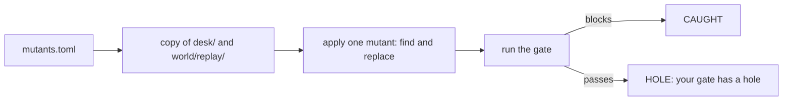

# Mutate the agent

## The problem

Your gate passes the desk agent. That is good news only if the gate would also fail a broken agent. A gate that
always says yes looks the same as a gate that works, until the day it matters.

So you break the agent on purpose and watch the gate. A mutant is one small, deliberate break. If the gate
passes a mutant, your gate has a hole.



## Your challenge

Write three mutants in `mutants.toml`. The first one, `no-value-index`, is done for you. Each mutant names a
file, a `find` text and a `replace` text. The runner changes a throwaway copy, never your repo.

1. `no-value-index`: the value index finds nothing, so no spelling of Sao Paulo is found. Done.
2. `customer-id`: in `world/replay/finished.jsonl`, the model's plans count `customer_id` instead of
   `customer_unique_id`. That is a model that forgot the trap.
3. `no-validator`: in `desk/finished/guard.py`, `check()` returns the SQL without checking it.

For example, this mutant is the first one:

```toml
[[mutant]]
name = "no-value-index"
file = "desk/finished/values.py"
find = "    groups = index()[column]"
replace = "    groups = {}"
```

Run the mutation run:

```bash
bun parts/09-gate-every-change/mutate.ts --mutants parts/09-gate-every-change/03-mutate-the-agent/problem/mutants.toml --rules parts/09-gate-every-change/03-mutate-the-agent/problem/gate-rules.ts
```

Expect: `CAUGHT  no-value-index: trap spelling: only 0 of 2 questions still match`, then one line per mutant
you add, and `3 of 3 mutants caught.`

## Done when

- `mutants.toml` lists at least 3 mutants, and each one's `find` text is really in its file.
- They break the value index, the customer id and the SQL validator.
- The gate passes the unbroken agent and blocks every mutant.

```bash
bun run verify mutate-the-agent
```

Expect: `Done. All 5 rules pass.`

## If you get stuck

| What you see                                 | Fix                                                                         |
| -------------------------------------------- | --------------------------------------------------------------------------- |
| `it cannot run: its find text is not in ...` | Copy the text from the file itself, spaces included.                        |
| `HOLE  no-validator: your gate has a hole`   | The mutant changed a comment, not code. Change the first line of `check()`. |
| `it cannot run: its file must be inside ...` | A mutant may change only `desk/` or `world/replay/`.                        |

## Words you will use

- **Mutant**: a copy of the agent with one deliberate break.
- **Mutation run**: run the gate once per mutant and expect it to block each one.
- **Hole**: a break the gate does not notice.
