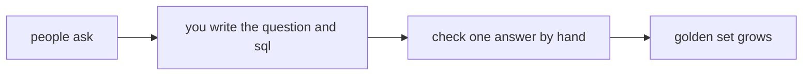

# Add real questions

## The problem

The course authors wrote the golden set. Real people ask different things. For example, a support lead asks, "How many orders were canceled last year?" Nobody on the course wrote that question. If the gate never sees what people really ask, it guards the wrong doors.

## Your challenge

Open `real-questions.toml` in this folder. Add at least five questions that people on your desk really ask. Ask a teammate if you do not have five.

1. Give each one an `id`, the `question`, `source = "real"`, and who asked it in `asked_by`.
2. Write one `SELECT` in `sql` that answers it on the course database. Run it by hand first.
3. Name its `traps` from the golden set, or leave the list empty.
4. Write a `note` that says how you checked the answer by hand.



Run the check:

```bash
bun run verify add-real-questions
```

Expect: `Done. All 5 rules pass.` once your five questions are in.

## Done when

- There are five questions, each marked `source = "real"` with who asked it.
- No id or question repeats the golden set or another of yours.
- Each query is one `SELECT` that returns rows.
- Trap labels are real ones, and two questions name a trap.
- Each note says how you checked the answer by hand.

## If you get stuck

| What you see                     | Fix                                                              |
| -------------------------------- | ---------------------------------------------------------------- |
| `FAIL no id and no question`     | Change the id. Ask a new question, not a copy of the golden one. |
| `FAIL every query is one SELECT` | Run the query by hand. A `;` in the middle or no rows fails it.  |
| `FAIL every question has a note` | Say what you counted and what you compared it with.              |

## Words you will use

- **Real question**: one that a person on the desk actually asked. You did not make it up.
- **Trap**: a reason a question is hard in this data, such as spelling or fan-out.
- **By hand**: checked on a small slice, by you, without the agent.
