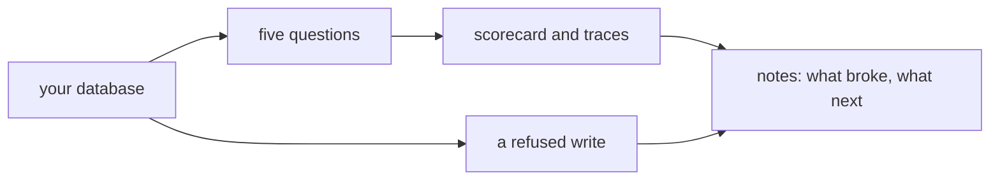

# Do it on yours

## The problem

You have built a desk on the course data. Does it hold up on yours? For example, a bakery has one small database
and five questions, and none of them are about Sao Paulo. This step is the proof. You hand in a folder of evidence
from your own data, and the check reads that folder, never the course world.

## Your challenge

Fill in every file in this folder, using your own SQLite file. The earlier steps showed each part.

1. `capstone.toml`: your `path` and who reads the answers.
2. `golden.toml`: five questions with one `SELECT` each. Use the shape from the point-at-your-database step.
3. `scorecard.json`: one line per question with its real `rows` count and `passed`. Run each query to get them.
4. `traces.jsonl`: three traces from the trace-the-cost step, for three of your questions.
5. `refusal.json`: a real request to change data, `"refused": true`, and the reason the desk gave.
6. `notes.md`: what broke on your data, and the one change you would make first.



Run the check on your folder:

```bash
bun run verify do-it-on-yours
```

Expect: `Done. All 6 rules pass.` when your evidence is real. The check runs your queries again, so a made-up
count fails.

## Done when

- `capstone.toml` names your own file and who reads the answers.
- Five questions each return rows on your file.
- The scorecard has every question, and its counts match a fresh run.
- Three traces show seconds and cost.
- A refused write is saved with its reason.
- The notes say what broke and what you would change.

## If you get stuck

| What you see                      | Fix                                                                  |
| --------------------------------- | -------------------------------------------------------------------- |
| `FAIL the scorecard has a line`   | Run each query and copy its row count. Do not guess it.              |
| `FAIL at least three traces`      | The `question` in a trace must match a question in `golden.toml`.    |
| `FAIL notes.md says`              | Each paragraph needs about twenty words from what really happened.   |

## Words you will use

- **Capstone**: the last piece of work, done on your own data.
- **Evidence**: files that show the desk really ran, not only that you wrote about it.
- **Scorecard**: one line per question: did the answer pass, and how many rows came back.
