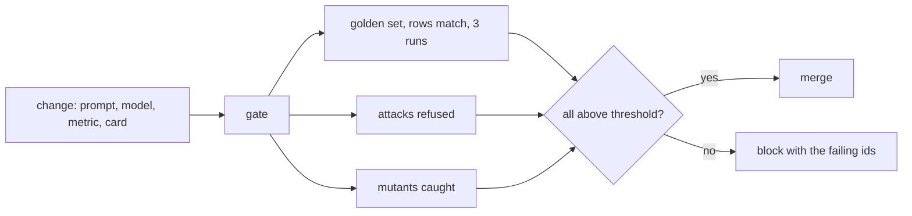

# Gate every change

This part is planned. Its steps do not exist yet. The table below says what each step will ask you to build, and
what its check will read.

## The problem

Anthropic watched its analytics accuracy fall from about 95% at launch to about 65% in a month. Then it started
to treat the fall as an engineering problem
([Anthropic](https://claude.com/blog/how-anthropic-enables-self-service-data-analytics-with-claude)).

A new model, a new column or an edited metric can break answers with no warning. One run is not proof either. Uber
reports that its test scores change by about 5% from one run to the next
([Uber Engineering](https://www.uber.com/blog/query-gpt/)).

A gate is a check that must pass before a change can go in. For example, someone edits the agent to count
`customer_id` again instead of `customer_unique_id`. The golden question `distinct-customers` then returns 99,441
instead of 96,096. The gate sees the miss and blocks the change.



## Steps

25 minutes in 3 steps.

| Step               | Minutes | You produce                                                                             | The check reads                                                                                          |
| ------------------ | ------- | --------------------------------------------------------------------------------------- | -------------------------------------------------------------------------------------------------------- |
| `gate-the-change`  | 10      | a gate that runs the golden set 3 times and the attacks once, and writes `SCORECARD.md` | the gate exits 0 on the solution; it fails under 27 of 30 on the median run or on any attack not refused |
| `catch-the-drift`  | 8       | a metric change updates `metrics.toml` and the golden references together               | changing only one of the two fails the gate with a message naming the metric                             |
| `mutate-the-agent` | 7       | a mutation run that breaks the agent on purpose                                         | every mutant (no value index, `customer_id`, no validator) makes the gate fail                           |

## Walkthrough

TODO(part session): one command per step, each with its Expect line.

```bash
bun run verify part gate-every-change
```

Expect: `Part gate-every-change is done: 3/3 steps pass.` once the steps exist.
