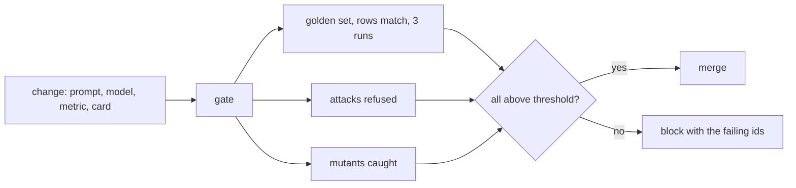

# Gate every change

This part is planned. Its steps are built by a later session; the table below is the contract for that work.

## The problem

Anthropic watched its offline analytics accuracy drift from about 95% at launch to about 65% over a month before
it treated the drift as an engineering problem
([Anthropic](https://claude.com/blog/how-anthropic-enables-self-service-data-analytics-with-claude)). A model swap,
a new column or an edited metric breaks answers silently. One run is not proof either: Uber reports about 5%
run-to-run variance in its evaluations ([Uber Engineering](https://www.uber.com/blog/query-gpt/)).



## Steps

25 minutes in 3 steps.

| Step | Minutes | You produce | The check reads |
|---|---|---|---|
| `gate-the-change` | 10 | a gate that runs the golden set 3 times and the attacks once, and writes `SCORECARD.md` | the gate exits 0 on the solution; it fails under 27 of 30 on the median run or on any attack not refused |
| `catch-the-drift` | 8 | a metric change updates `metrics.toml` and the golden references together | changing only one of the two fails the gate with a message naming the metric |
| `mutate-the-agent` | 7 | a mutation run that breaks the agent on purpose | every mutant (no value index, `customer_id`, no validator) makes the gate fail |

## Walkthrough

TODO(part session): one command per step, each with its Expect line.

```bash
bun run verify part gate-every-change
```

Expect: `Part gate-every-change is done: 3/3 steps pass.` once the steps exist.
