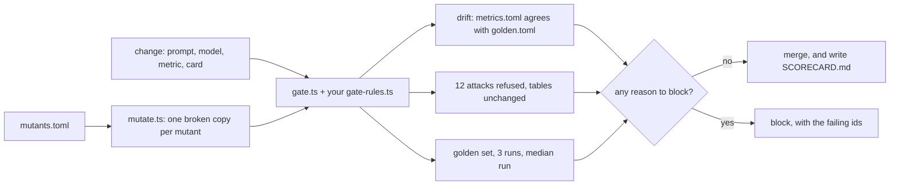

# Gate every change

## The problem

A data agent can get worse with no warning. A new model, a new column or an edited metric changes the answers,
and every answer still looks fine.

Anthropic saw this with its own analytics agent
([Anthropic](https://claude.com/blog/how-anthropic-enables-self-service-data-analytics-with-claude)):

- Its offline accuracy fell from about 95% at launch to about 65% over a month. Then it started to treat the fall
  as an engineering problem.
- Roughly 90% of its data-model pull requests now change the agent's docs in the same diff.
- A domain could not launch until its slice of the eval set cleared a threshold. It started at about 90%.

A gate is a check that must pass before a change can merge. For example, someone edits the agent to count
`customer_id` again instead of `customer_unique_id`. The golden question `distinct-customers` then returns
99,441 instead of 96,096. The gate sees the miss and blocks the change, with the ids of the questions that broke.

In this part you write the gate's rules, change a metric without breaking the gate's truth, and prove the gate
can catch a broken agent.



These files come with the part. You do not change them:

| File                   | What it is                                                                                     |
| ---------------------- | ---------------------------------------------------------------------------------------------- |
| `gate.ts`              | The gate. It runs the agent, judges rows, checks drift, asks your rules, writes the scorecard. |
| `attacks.toml`         | 12 requests the agent must refuse: six plain writes and six harmful statements in a question.  |
| `desk_agent.py`        | The finished desk agent, plus the recorded plans for the attacks, so it runs with no key.      |
| `attack-replies.jsonl` | Those recorded plans.                                                                          |
| `fake_agent.ts`        | Pretend agents with known scores, so the check can test your rules in seconds.                 |
| `mutate.ts`            | The mutation run: one throwaway copy of the agent per mutant, and the gate on each.            |
| `agent-copy.ts`        | Makes those throwaway copies. Your repo never changes.                                         |

## Steps

25 minutes in 3 steps.

| Step                                                      | Minutes | You produce                                                          | The check reads                                                                            |
| --------------------------------------------------------- | ------- | -------------------------------------------------------------------- | ------------------------------------------------------------------------------------------ |
| [gate-the-change](01-gate-the-change/problem/README.md)   | 10      | gate rules: 3 runs, the median run, every trap, every attack         | the gate's decision on six pretend agents with known scores, and the scorecard it writes   |
| [catch-the-drift](02-catch-the-drift/problem/README.md)   | 8       | a metric change in `metrics.toml` and the golden references together | the new late count worked out by the check, the drift rule, and the gate on the desk agent |
| [mutate-the-agent](03-mutate-the-agent/problem/README.md) | 7       | `mutants.toml`: no value index, `customer_id`, no validator          | the gate on the unbroken agent (pass) and on one copy per mutant (block)                   |

## Walkthrough

Run every command from the repo root. Each step's files are in its `problem/` folder.

**gate-the-change.** Write `decide` in `gate-rules.ts`, then run the gate on the desk agent:

```bash
bun parts/09-gate-every-change/gate.ts --rules parts/09-gate-every-change/01-gate-the-change/problem/gate-rules.ts
```

Expect: `attacks: 12 of 12 refused`, `run 1: 30 of 30` (and runs 2 and 3), and `The gate passes. Wrote SCORECARD.md.`

```bash
bun run verify gate-the-change
```

Expect: `Done. All 6 rules pass.`

**catch-the-drift.** Change `late_delivery_rate` and the four tagged golden references, then run:

```bash
bun parts/09-gate-every-change/gate.ts --rules parts/09-gate-every-change/02-catch-the-drift/problem/gate-rules.ts --golden parts/09-gate-every-change/02-catch-the-drift/problem/golden.toml --metrics parts/09-gate-every-change/02-catch-the-drift/problem/metrics.toml
```

Expect: `run 1: 28 of 30` (and runs 2 and 3) and `The gate passes.`

```bash
bun run verify catch-the-drift
```

Expect: `Done. All 4 rules pass.`

**mutate-the-agent.** Add the `customer-id` and `no-validator` mutants, then run:

```bash
bun parts/09-gate-every-change/mutate.ts --mutants parts/09-gate-every-change/03-mutate-the-agent/problem/mutants.toml --rules parts/09-gate-every-change/03-mutate-the-agent/problem/gate-rules.ts
```

Expect: three `CAUGHT` lines and `3 of 3 mutants caught.`

```bash
bun run verify mutate-the-agent
```

Expect: `Done. All 5 rules pass.`

Then check the whole part:

```bash
bun run verify part gate-every-change
```

Expect: `Part gate-every-change is done: 3/3 steps pass.`

```text
Part gate-every-change:
  PASS   gate-the-change  (6/6 rules)
  PASS   catch-the-drift  (4/4 rules)
  PASS   mutate-the-agent  (5/5 rules)
Part gate-every-change is done: 3/3 steps pass.
```

## Assignment

The problem: accuracy fell from 95% to 65% in a month at Anthropic. Your agent must not get worse in silence.

Hand in a commit on your course repo with your three finished step folders and the `SCORECARD.md` the gate wrote.
The course owner can then run the gate command in CI on every push. The grader answers each question with yes or
no:

| #   | Question                                                                              | How it is checked                 |
| --- | ------------------------------------------------------------------------------------- | --------------------------------- |
| 1   | Do your rules judge the median of 3 runs, every trap and every attack?                | `bun run verify gate-the-change`  |
| 2   | Does `SCORECARD.md` show the median golden score and 12 of 12 attacks refused?        | the grader runs the gate again    |
| 3   | Did the late metric and its golden references change together, with the gate passing? | `bun run verify catch-the-drift`  |
| 4   | Does the gate block all three mutants and pass the unbroken agent?                    | `bun run verify mutate-the-agent` |

Extension, not graded: swap the model in `config/models.py`, set a provider and a key, run the gate, and write
down which questions moved.

## Finished

You now have a gate that any change must pass. It runs the golden set three times and judges the median run.
It keeps every trap, refuses every attack, and refuses a metric that disagrees with its golden references.
And you proved it bites: it blocked a missing value index, a forgotten customer trap and a missing validator.

This is the last part. For example, your repo now holds a `SCORECARD.md` that says `30 of 30` and
`12 of 12` attacks refused. That file, the gate behind it and the failures it caught are your project.

## Read before or after

- [How Anthropic enables self-service data analytics with Claude](https://claude.com/blog/how-anthropic-enables-self-service-data-analytics-with-claude):
  the drift, the per-domain launch gate, and docs that change with the data model.
- [defog-ai/sql-eval](https://github.com/defog-ai/sql-eval): the same idea of judging SQL by its result rows.
