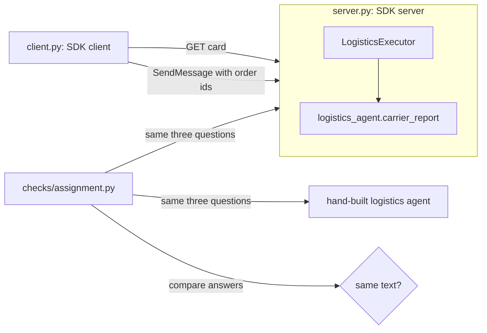

# Serve with the SDK

## The problem

In delegate-over-a2a you used a small A2A server written with the Python standard library. It was good for
learning, because you could read every line. Teams that run A2A in production do not write that part. They use
the official SDK, the code library the A2A project publishes. It handles the card route, the JSON-RPC route,
task ids, task states and streaming.

In this step you serve the same logistics agent with `a2a-sdk` 1.3.0. The agent's work does not change. For example, order 9b189f6c still gets the same carrier and the same reason. You wrap
its function in the SDK's server, then call it from the SDK's client.



## Your challenge

Open `server.py` in this folder. It imports the SDK and the agent function. It does not serve anything yet.

Write three things:

1. A `LogisticsExecutor` that extends `AgentExecutor`. Its `execute` reads the `order_ids` from the message's
   data part, calls `logistics_agent.carrier_report`, adds the report as an artifact, and completes the task.
2. A function that builds the `AgentCard`. Reuse `logistics_agent.SKILL` for the skill.
3. An app. Pass the executor, a task store and the card to `DefaultRequestHandler`, add the card route and the
   JSON-RPC route, and start it with `uvicorn`.

Do not copy the agent's logic into `server.py`. The executor calls the function and passes on what it returns.

`client.py` is ready. Start your server in one terminal:

```bash
uv run parts/10-do-it-with-the-tools-teams-run/01-serve-with-the-sdk/problem/server.py --port 8812
```

Expect: `The SDK agent is serving on http://127.0.0.1:8812`. Press Ctrl+C when you are done.

Then ask a question with the SDK client in a second terminal:

```bash
uv run parts/10-do-it-with-the-tools-teams-run/01-serve-with-the-sdk/problem/client.py http://127.0.0.1:8812 9b189f6cf2ef734a7dd0419ed3c64d99
```

Expect: `9b189f6c: Carrier Coast, sent back to the depot after a failed delivery attempt.`

## Done when

- `server.py` pins `a2a-sdk==1.3.0` and that version is the one that runs.
- The agent card your server serves validates against the A2A 1.0 schema from delegate-over-a2a.
- The three course queries return the same text as the hand-built logistics agent.

```bash
bun run verify serve-with-the-sdk
```

Expect: `Done. All 3 rules pass.`

## If you get stuck

| What you see                          | Fix                                                                               |
| ------------------------------------- | --------------------------------------------------------------------------------- |
| `TODO: write the executor`            | You have not wired the app yet. Replace the body of `main`.                       |
| `the server stopped`                  | Run the server command yourself and read the error it prints.                     |
| `expected '9b189f6c: ...', got '...'` | The executor must return `logistics_agent.summary_of(report)` as a text part.     |
| `a2a-sdk 1.x is installed`            | Pin `a2a-sdk[http-server]==1.3.0` in the script header at the top of `server.py`. |

## Words you will use

- **SDK**: a software development kit, a library that does the common work of a protocol for you.
- **Executor**: the class where you put what the agent does. The SDK calls it for each task.
- **Task store**: the place the SDK keeps tasks while they run. The in-memory one forgets them on restart.
- **Artifact**: the result of a task. Here it holds the carrier report.
