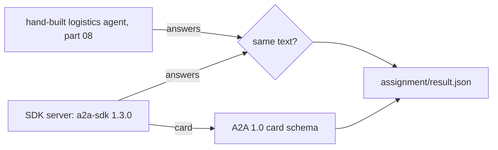

# Serve the logistics agent with a2a-sdk

## The problem

You built an A2A server by hand in delegate-over-a2a. You learned what a card, a task and a state are. Now
suppose your team ships this agent. Nobody wants to own a hand-made JSON-RPC server, and a gap in it is a gap
in your security. This part redoes one thing you built by hand with the open-source tool teams run.

## Why it matters

The hand-built server and the SDK server must give the same answers. For example, both say that order 9b189f6c was sent back to the depot after a failed delivery attempt. If they do, you can swap the tool without
changing what other agents see. The check in this part proves it on three real questions.



## What we teach

- How the official `a2a-sdk` splits a server into an executor, a card, a request handler and routes.
- How to keep the agent's logic in one place and wrap it, so the tool never owns your logic.
- How to compare a tool against the version you built by hand, on the same questions.

## Steps

15 minutes in 1 step. Part 08 must be done first, because the step reuses its logistics agent and card schema.

| Step                                                          | Minutes | You produce                                     | The check reads                                        |
| ------------------------------------------------------------- | ------- | ----------------------------------------------- | ------------------------------------------------------ |
| [serve-with-the-sdk](01-serve-with-the-sdk/problem/README.md) | 15      | the logistics agent served with `a2a-sdk` 1.3.0 | the card, and the answers to 3 questions, from the SDK |

## Walkthrough

Run every command from the repo root. A server keeps running, so give it its own terminal and stop it with Ctrl+C.

**serve-with-the-sdk.** Write the executor, the card and the app in `server.py`, then start it:

```bash
uv run parts/10-serve-the-logistics-agent-with-a2a-sdk/01-serve-with-the-sdk/problem/server.py --port 8812
```

Expect: `The SDK agent is serving on http://127.0.0.1:8812`.

Ask it with the SDK client in a second terminal:

```bash
uv run parts/10-serve-the-logistics-agent-with-a2a-sdk/01-serve-with-the-sdk/problem/client.py http://127.0.0.1:8812 9b189f6cf2ef734a7dd0419ed3c64d99
```

Expect: `9b189f6c: Carrier Coast, sent back to the depot after a failed delivery attempt.`

```bash
bun run verify serve-with-the-sdk
```

Expect: `Done. All 3 rules pass.`

To see a finished one pass, run the check on the reference solution:

```bash
bun run verify serve-with-the-sdk solution
```

Expect: `Done. All 3 rules pass.`

## Options

**ADK's A2A support.** Google's Agent Development Kit can serve an agent over A2A without you writing an executor.

- Choose when: the agent already runs on ADK, so its A2A support is one line away.
- Trade-off: it ties the agent to that framework. The SDK keeps your agent function independent of any framework.

Write your own choice in `CHOICE.md` in the assignment folder. Two sentences are enough.

## Assignment

Optional in the live session. Expected as homework. The task, the Done-when lines and the rubric are in
[assignment/README.md](../../assignment/README.md).

## Finished

Your logistics agent now runs on the official SDK, with the same card shape and the same answers as the one you
built by hand. You can explain what the SDK did for you, and what it would cost to leave it.
