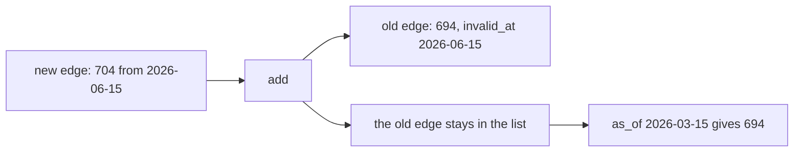

# Track changed facts with Graphiti

## The problem

In March the desk told an ops lead that Sao Paulo city had 694 sellers. After the city-spelling fix, the
desk says 704. The old answer was overwritten, so nobody can ask what the desk believed in March.
For example, a report must show 704 now. A replay of the March question must still show 694.



## Your challenge

Open `changes.py` in this folder. It loads the desk's dated facts as Graphiti `EntityEdge` objects. It asks six
questions and prints the answers. Write two functions.

1. `add(edges, new_edge)`. When a new edge arrives for a fact, close the older current edge. Set its
   `invalid_at` to the new edge's `valid_at`. Never delete it. Graphiti already has this rule:
   `resolve_edge_contradictions`, in `graphiti_core.utils.maintenance.edge_operations`. Use it.
2. `as_of(edges, fact_key, when)`. Return the value that was true on that date. Return `None` if no edge was
   true yet.

Edges can arrive in any order. Sort the edges of a fact by `valid_at` before you close any of them.

Run the file from the repo root:

```bash
uv run parts/11-track-changed-facts-with-graphiti/01-track-the-change/problem/changes.py world/graphiti/facts.json
```

Expect: one line of JSON, with an `answers` list and an `edges` list.

## Done when

- `add` closes the old Sao Paulo city edge, and the old edge is still in the list.
- `as_of` gives 694 for 2026-03-15 and 704 for 2026-07-01.
- The Sao Paulo state edge stays open, because its value never changed.

```bash
bun run verify track-the-change
```

Expect: `Done. All 8 rules pass.`

## Rubric

1. Old facts are closed, never deleted.
2. A date question gets the value true on that date.
3. An unchanged fact is left alone.

## What this check does not prove

The check uses hand-written edges and needs no database and no model key. It does not prove that a live
Graphiti, with a real model, reads a text and dates its facts correctly. That needs your own key and is not
checked here.

## If you get stuck

| What you see                                     | Fix                                                                              |
| ------------------------------------------------ | -------------------------------------------------------------------------------- |
| `error: Failed to download` from `uv`            | Check your network, then run the command again. `uv` fetches graphiti-core once. |
| `FAIL every fact has exactly one current edge`   | The old edge still has no `invalid_at`. Close it in `add`.                       |
| `FAIL as_of gives 694 on 2026-03-15 ...`         | `as_of` must check the start and the end date of each edge, not only the start.  |
| `FAIL reversed input gives the same answers ...` | Your `add` depends on arrival order. Sort the edges by `valid_at` first.         |

## Words you will use

- **Edge**: one dated fact in Graphiti.
- **valid_at**: the date a fact became true.
- **invalid_at**: the date a fact stopped being true. An empty `invalid_at` means it is still true.
- **As-of question**: a question that asks what was true on one date.
