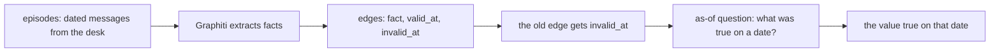

# Track changed facts with Graphiti

## The problem

The desk gave a number that later changed. In March it said Sao Paulo city had 694 sellers. After a spelling
fix, it says 704. Part 04 keeps verified questions and their SQL, but it overwrites them. So nobody can ask
what the desk believed in March, or when the belief changed.

## Why it matters

A report needs the value true now. An audit needs the value true on an old date. If you keep only the newest
value, the old answer is gone. If you add the new value and never close the old one, two values look current.
For example, a replay of a March question must still give 694, while the report gives 704.



## What we teach

- A fact in Graphiti is an edge with a start date (`valid_at`) and an end date (`invalid_at`).
- A change closes the old edge. It never deletes it.
- A date question returns the value true on that date, or nothing before the first edge.

## Steps

About 20 minutes in 1 step.

| Step                                                      | Minutes | You produce                         | The check reads                                                      |
| --------------------------------------------------------- | ------- | ----------------------------------- | -------------------------------------------------------------------- |
| [track-the-change](01-track-the-change/problem/README.md) | 20      | `changes.py` with `add` and `as_of` | the answers to six questions, and the edges the file keeps (8 rules) |

## Walkthrough

Run every command from the repo root.

**Run the finished sample.** It prints the answers for the desk's six questions.

```bash
uv run parts/11-track-changed-facts-with-graphiti/01-track-the-change/solution/changes.py world/graphiti/facts.json
```

Expect: one line of JSON. Its `answers` show `"694"` for 2026-03-15 and `"704"` for 2026-07-01.

**Check your work on the step.**

```bash
bun run verify track-the-change
```

Expect: `Done. All 8 rules pass.`

**Check the sample solution.**

```bash
bun run verify track-the-change solution
```

Expect: `Done. All 8 rules pass.`

**Read-only: a graph database, needs your own key, not checked.** Graphiti stores its edges in a graph
database. This command starts Neo4j in Docker. The course does not run it, and the check does not use it.
The live Graphiti also needs a model key, which you set yourself.

```bash
docker run --rm -p 7687:7687 neo4j:5
```

Expect: Neo4j starts and listens on port 7687. This is not checked here.

## Options

**Graphiti.**

- Choose when: you must answer "what was true on that date?" and keep the old value.
- Trade-off: it needs a graph database and a model call for each episode.

**Mem0, the runner-up.**

- Choose when: you need simple memory for each user.
- Trade-off: it has no built-in validity dates on a fact. Mem0 2.2.1 on PyPI is Apache-2.0 on GitHub.

**Graph databases for Graphiti.** Check the license before you choose one for a company.

- Neo4j Community Edition: GPL-3.0, from its repository license file.
- FalkorDB server: SSPL version 1, from its repository license file.
- Kuzu: embedded and MIT on PyPI. Its last PyPI release, 0.11.3, is from October 2025. Its maintenance is not confirmed here.
